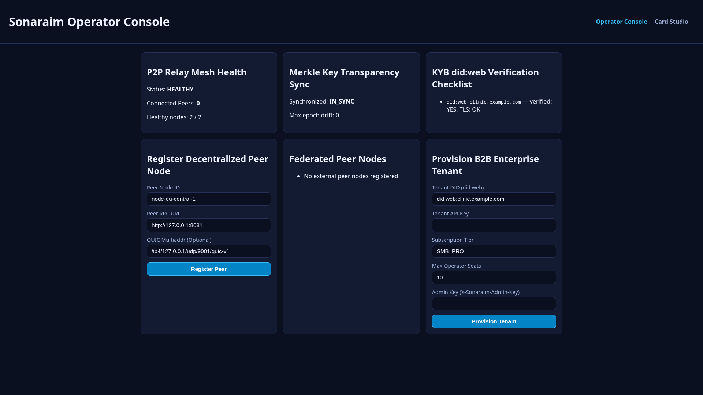
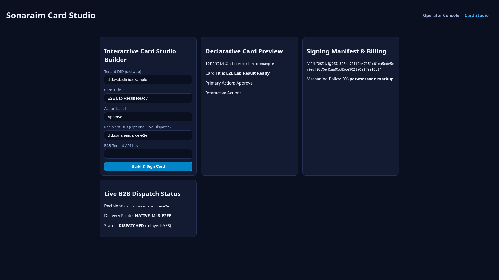

# Sonaraim Admin (`sonaraim-admin`)

> Dual-Console Web Application: Node Operator Telemetry & B2B Tenant Card Studio.

[](LICENSE)
[](package.json)
[](src/operatorConsole.mjs)
[](src/authGate.mjs)
[](src/operatorConsole.mjs)

`sonaraim-admin` provides the control plane, operational telemetry evaluators, and declarative UI authoring tools for the Sonaraim sovereign communication ecosystem. It cleanly separates infrastructure governance (Node Operator & Super Admin Console) from commercial message orchestration (B2B Tenant Console & Visual Card Studio) while preserving strict zero-knowledge and zero-remote-code-execution guarantees.

---

## ⚡ Key Capabilities

- **Super Admin & Node Operator Console (`src/operatorConsole.mjs`, `src/ui/operatorView.mjs`)**:
  - Real-time P2P relay mesh health evaluation (latency, packet loss, stream count, degraded node alerts).
  - Federated Merkle epoch synchronization validator with drift and split-brain detection.
  - Automated KYB (`did:web`) verification checklist (DID document reachability, TLS chain validation, Ed25519 key presence, DNS TXT challenge).
  - Dynamic peer node registration (`POST /operator/peers`) and tenant provisioning (`POST /operator/tenants`).
- **B2B Tenant Console & Visual Card Studio (`src/cardStudio.mjs`, `src/ui/studioView.mjs`)**:
  - Declarative builder and schema validator for `Sonaraim Cards` (`sonaraim.card.v1`).
  - Strict rejection of unsafe components (`iframe`, raw HTML, executable JavaScript).
  - Deterministic JCS SHA-256 digest creation and signing manifest generation.
  - Live card dispatch to `sonaraim-b2b` (`POST /v1/messages`) via `POST /studio/cards`.
- **Zero-Trust Operator Authentication Gate (`src/authGate.mjs`)**:
  - Constant-time Bearer token and HMAC-SHA256 session cookie (`sonaraim_operator_session`) validation.
  - Accessible login form (`GET /login`, `POST /login`).
- **Telemetry Probing & Prometheus Metrics (`src/apiClient.mjs`, `src/server.mjs`)**:
  - Probes upstream `sonaraim-node` and `sonaraim-b2b` with timeout boundaries (`GET /api/live-telemetry`).
  - Exposes Prometheus scrape metrics (`GET /metrics`).
- **Tenant Billing & Seat Governance (`src/tenantBilling.mjs`)**:
  - Seat limit tracking, tier quotas, and zero per-message fee verification.

---

## 📸 Screenshots

| Node Operator Telemetry & KYB Console | Visual Card Studio & Schema Builder |
| :---: | :---: |
|  |  |

---

## 🏗️ Dual-Console Architecture & Data Flow

The following ASCII diagram illustrates the operational segregation between Node Operator telemetry and B2B Card Studio workflows:

```text
+-----------------------------------------------------------------------------------+
|                        SONARAIM ADMIN DUAL-CONSOLE SYSTEM                         |
+-----------------------------------------------------------------------------------+
|                                                                                   |
|  [Node Operator / Super Admin]              [B2B Tenant / Enterprise Designer]    |
|  - Authenticated via Session / Bearer       - Authenticated via Tenant Token      |
|  - Controls mesh infrastructure             - Designs rich interactive cards      |
|            |                                              |                       |
|            v                                              v                       |
|  +-----------------------------------------------------------------------------+  |
|  |                 ZERO-TRUST OPERATOR AUTH GATE (authGate.mjs)                |  |
|  |       Constant-time Bearer token & HMAC-SHA256 session cookie validation    |  |
|  +-------------------------------------+---------------------------------------+  |
|                                        |                                          |
|                +-----------------------+----------------------+                   |
|                |                                              |                   |
|                v                                              v                   |
|  +---------------------------+              +----------------------------------+  |
|  |    NODE OPERATOR CONSOLE  |              |        VISUAL CARD STUDIO        |  |
|  | (operatorConsole.mjs)     |              | (cardStudio.mjs, studioView.mjs) |  |
|  |                           |              |                                  |  |
|  | * P2P Relay Mesh Latency  |              | * Zero-HTML Component Tree       |  |
|  | * Merkle Epoch Sync Drift |              | * Strict JSON Schema Validation  |  |
|  | * Verifiable did:web KYB  |              | * JCS SHA-256 Digest Preview     |  |
|  | * Dynamic Peer Additions  |              | * Direct Card Dispatch to B2B    |  |
|  +-------------+-------------+              +-----------------+----------------+  |
|                |                                              |                   |
|                | Upstream Probing & Multiaddr                 | Message Dispatch  |
|                v                                              v                   |
|  +---------------------------+              +----------------------------------+  |
|  |       sonaraim-node       |              |           sonaraim-b2b           |  |
|  |     (Relay & Ledger)      |              |     (Enterprise E2EE Bridge)     |  |
|  +---------------------------+              +----------------------------------+  |
|                                                                                   |
|  TELEMETRY & MONITORING:                                                          |
|  - GET /api/live-telemetry -> Aggregated node latency, B2B uptime, Merkle head    |
|  - GET /metrics -> Prometheus scrape target for operator dashboard metrics        |
+-----------------------------------------------------------------------------------+
```

> [!NOTE]
> For full Mermaid sequence diagrams of authentication flows, KYB verification pipelines, and card signing workflows, see [docs/DIAGRAMS.md](docs/DIAGRAMS.md).

---

## 📊 HTTP Endpoints Summary

| Method | Endpoint | Auth | Purpose |
| :--- | :--- | :--- | :--- |
| `GET` | `/health` | Public | Service health and upstream base URLs |
| `GET` | `/metrics` | Public | Prometheus scrape metrics |
| `GET` | `/login` | Public | Operator sign-in view |
| `POST` | `/login` | Public | Validate operator token and issue session cookie |
| `GET` | `/operator` | Session/Bearer | Node Operator Console view |
| `POST` | `/operator/tenants` | Session/Bearer | Provision B2B enterprise tenant on upstream B2B |
| `POST` | `/operator/peers` | Session/Bearer | Register P2P peer on upstream relay node |
| `GET` | `/studio` | Session/Bearer | Visual Card Studio editor view |
| `POST` | `/studio/cards` | Session/Bearer | Build, validate, and optionally dispatch card to B2B |
| `GET` | `/api/live-telemetry` | Session/Bearer | Aggregated upstream node and B2B telemetry probe |
| `GET` | `/api/billing/summary` | Session/Bearer | Tenant seat quota and billing summary |

---

## 🧩 Repository Layout

```text
sonaraim-admin/
├── docs/
│   ├── ARCHITECTURE.md       # Dual-console system design & ASCII layouts
│   ├── CONFIGURATION.md      # Environment variable specifications
│   ├── DIAGRAMS.md           # Mermaid sequence and state diagrams
│   └── STANDARDS.md          # Coding, testing, and linting rules
├── samples/
│   └── .env.example          # Sample environment configuration template
├── src/
│   ├── apiClient.mjs         # Upstream Node and B2B HTTP client
│   ├── authGate.mjs          # Zero-trust session cookie and Bearer auth gate
│   ├── cardStudio.mjs        # Sonaraim Card builder & validation logic
│   ├── config.mjs            # Zero-hardcode environment variable loader
│   ├── httpHelpers.mjs       # HTTP request parsing and response helpers
│   ├── index.mjs             # Public package exports
│   ├── main.mjs              # Standalone CLI server entry point
│   ├── operatorConsole.mjs   # Mesh health, Merkle sync & KYB evaluators
│   ├── server.mjs            # HTTP request router and metrics state
│   ├── tenantBilling.mjs     # Seat quotas and flat-rate billing ledger
│   └── ui/
│       ├── htmlUtils.mjs     # HTML escaping and shell rendering
│       ├── loginView.mjs     # Operator login view renderer
│       ├── operatorView.mjs  # Operator Console view renderer
│       └── studioView.mjs    # Visual Card Studio view renderer
├── tests/
│   └── admin.test.mjs        # Node.js native test runner suite
├── CODE_OF_CONDUCT.md        # Contributor Covenant v2.1
├── CONTRIBUTING.md           # Development, TDD & git workflow guide
├── LICENSE                   # Apache License 2.0
├── package.json              # ESM package manifest (Apache-2.0)
└── SECURITY.md               # Vulnerability disclosure & zero-trust model
```

---

## 🚀 Quick Start

### Build & Test

```bash
# 1. Run all unit and integration tests
npm test

# 2. Markdown linting
npx --yes markdownlint-cli2 "*.md" "docs/*.md"
```

---

## 🌐 Collaboration & Governance

- **[Contributing Guide](CONTRIBUTING.md)** — Branching model (`develop`), TDD mandate, and commit conventions.
- **[Code of Conduct](CODE_OF_CONDUCT.md)** — Community standards and enforcement guidelines.
- **[Security Policy](SECURITY.md)** — Vulnerability reporting, SLAs, and administrative threat model.
- **[Configuration Guide](docs/CONFIGURATION.md)** — Complete environment variable reference.
- **[Architecture Specification](docs/ARCHITECTURE.md)** — Detailed dual-console design and ASCII layouts.
- **[System Diagrams](docs/DIAGRAMS.md)** — Mermaid sequence, state, and interaction diagrams.

---

## 📜 License

Licensed under the Apache License, Version 2.0. See [LICENSE](LICENSE) for details.

Copyright 2026 Sonaraim Contributors.
