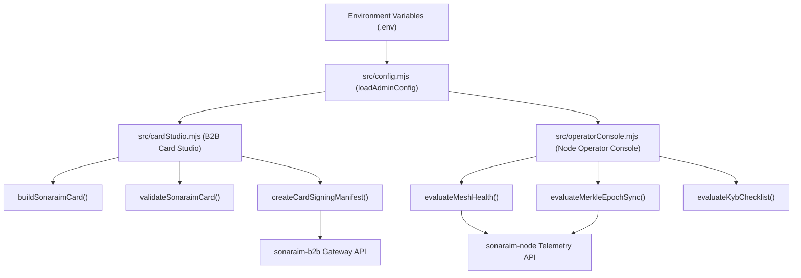
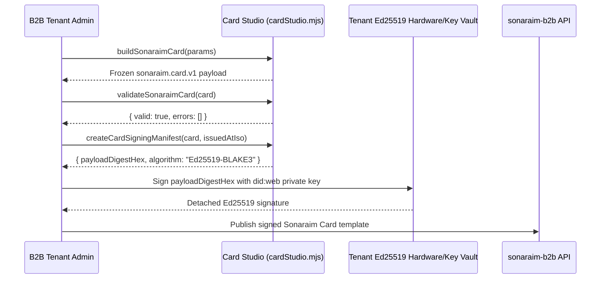
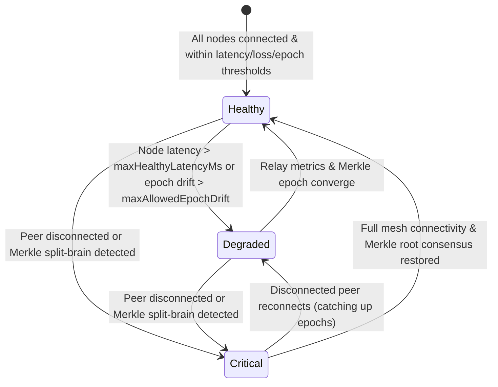

# System Diagrams (`sonaraim-admin`)

> Mermaid architecture, sequence, and state diagrams for the Sonaraim Dual-Console Web Application.

## 1. Dual-Console Component Architecture

## 2. B2B Declarative Card Authoring & Signing Sequence

## 3. Node Operator P2P Mesh & Merkle Health State Machine

