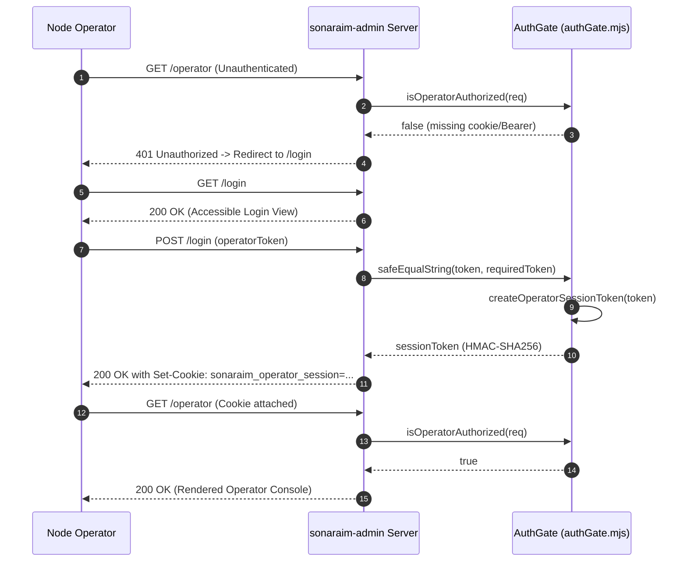
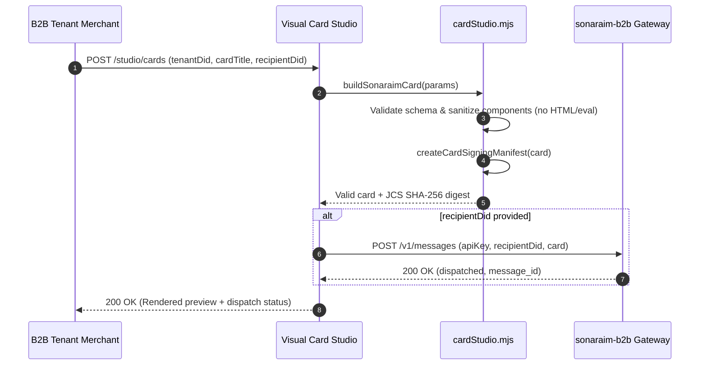
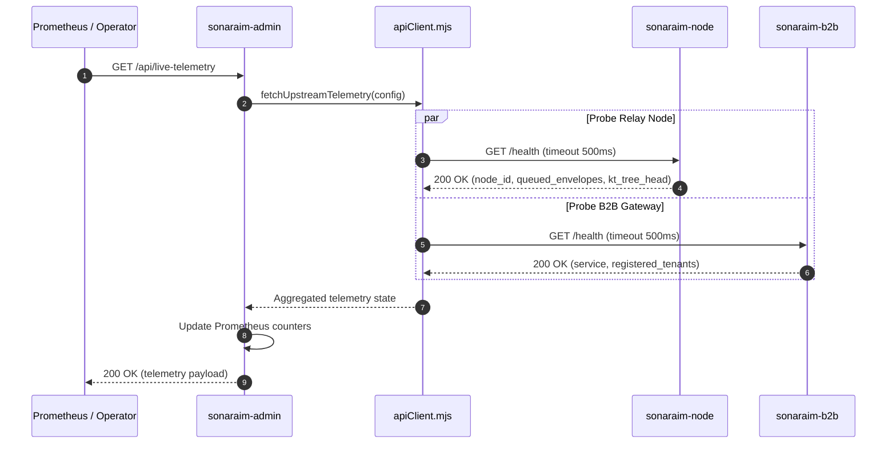
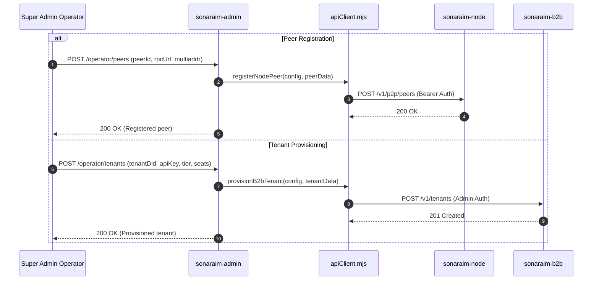

# System Diagrams (`sonaraim-admin`)

> Mermaid sequence, state, and interaction diagrams for `sonaraim-admin`.

---

## 1. Operator Zero-Trust Login & Session Validation Flow

---

## 2. Card Studio Live Card Build & Dispatch Flow

---

## 3. Upstream Telemetry Aggregation & Health Evaluation

---

## 4. Dynamic Peer Registration & Tenant Provisioning Flow

